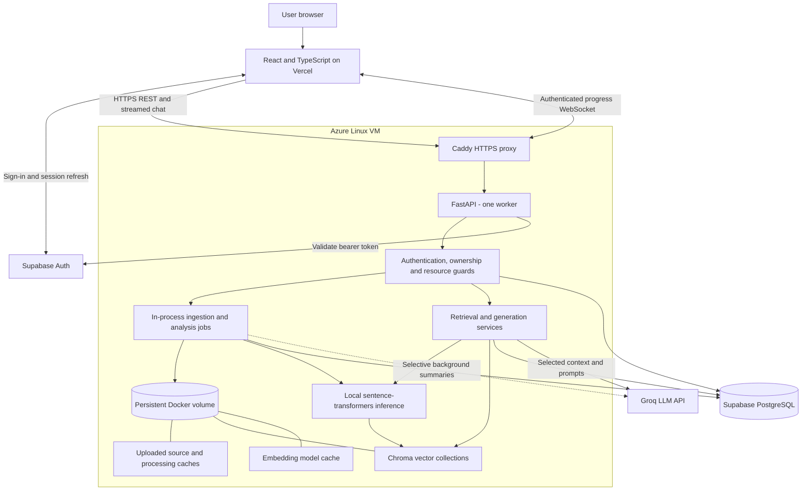
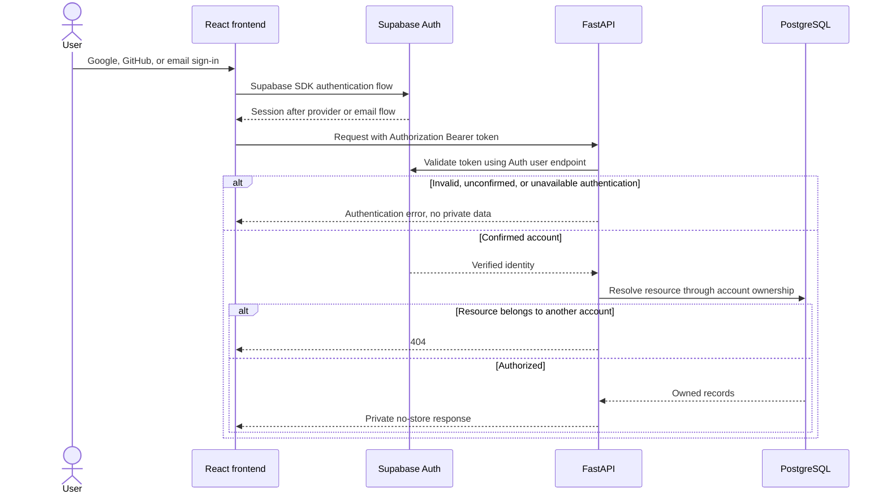
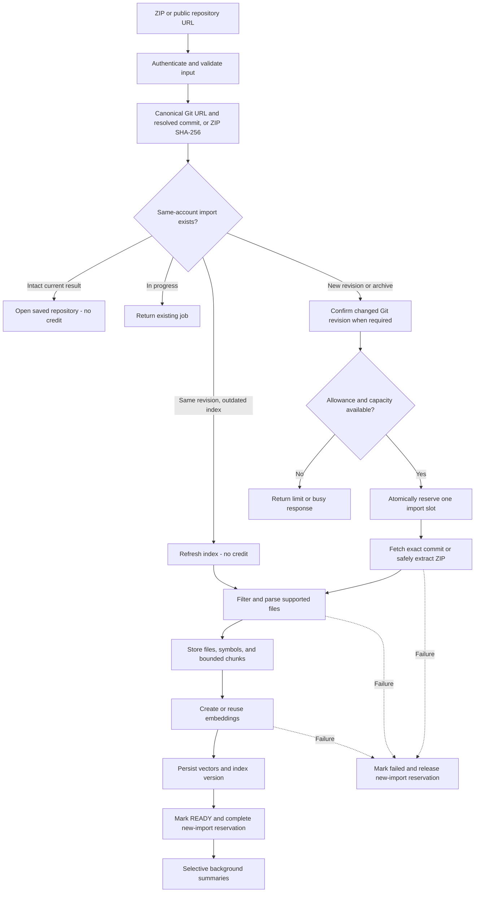
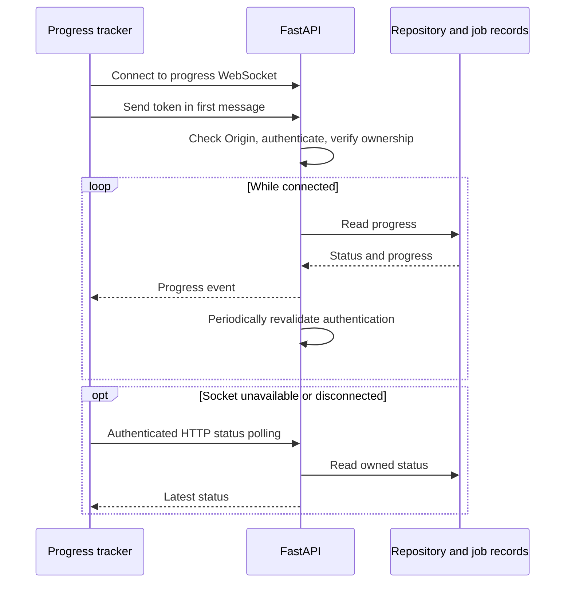
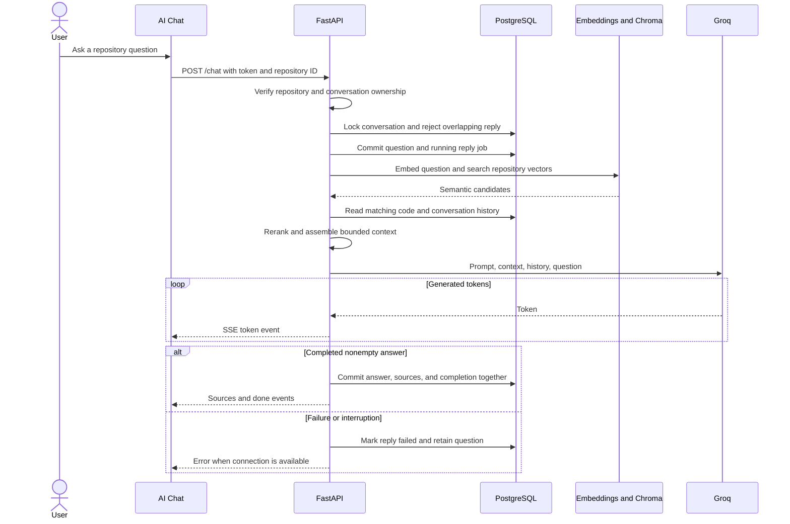
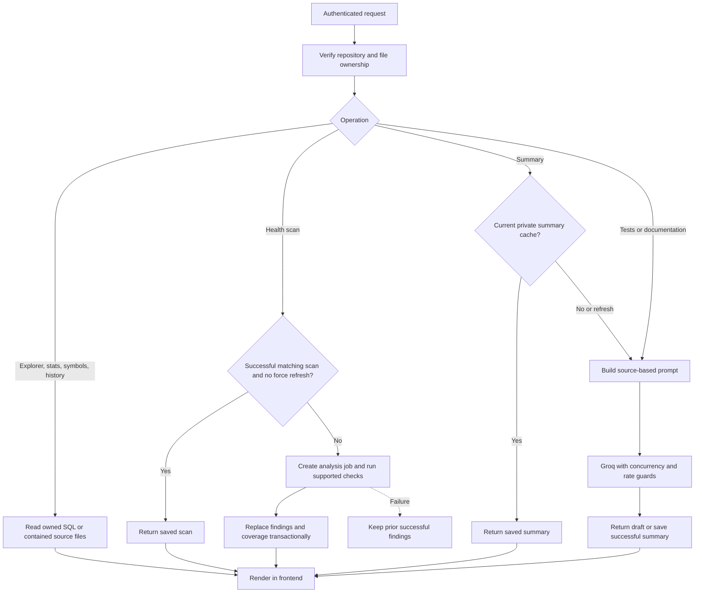
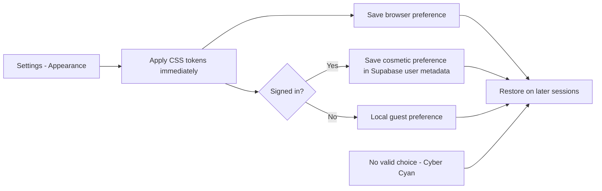
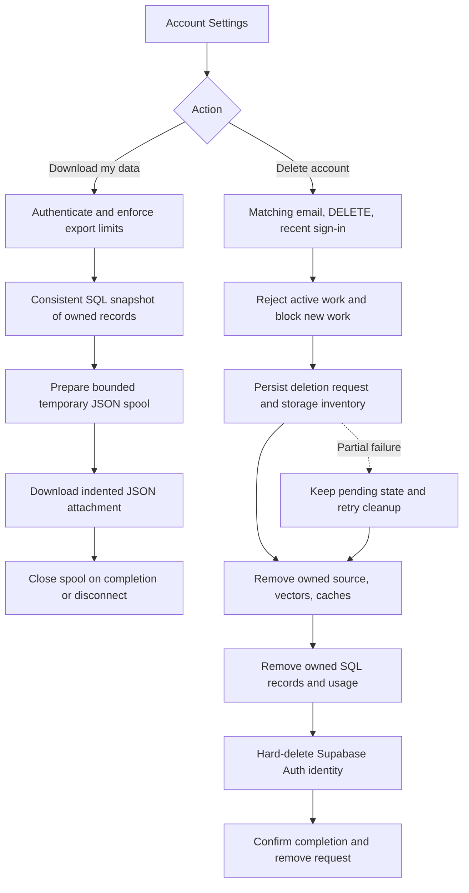
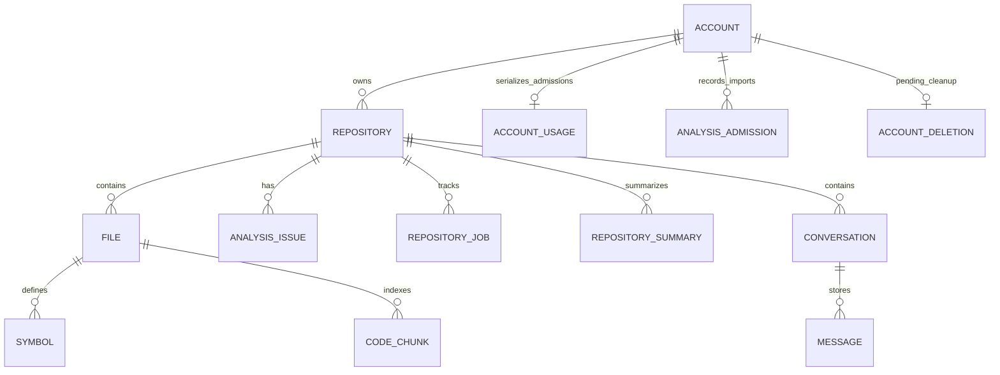
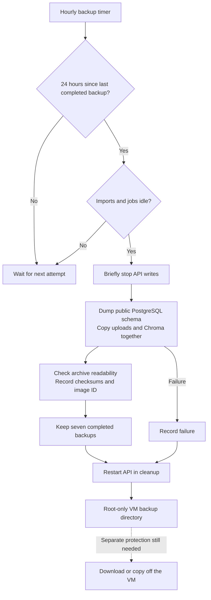

<div align="center">

# CodeLens AI

### Clarity starts with your code.

Explore repositories, ask questions with code context, and focus on the findings that matter—all in your own account workspace.

[](https://github.com/rock917/codelens-ai/actions/workflows/ci.yml)
[](https://github.com/rock917/codelens-ai/actions/workflows/backend.yml)
[](https://github.com/rock917/codelens-ai/actions/workflows/frontend.yml)

**[Open CodeLens](https://codelens-ai-five.vercel.app/) · [API reference](https://codelens-rock917-api.centralindia.cloudapp.azure.com/docs) · [Documentation](#documentation) · [Report an issue](https://github.com/rock917/codelens-ai/issues)**

React 19 · TypeScript · FastAPI · Supabase · ChromaDB · Groq

</div>

---

## Overview

CodeLens AI turns a public Git repository or ZIP upload into an explorable, searchable workspace. It extracts source structure, builds local embeddings, retrieves relevant code for AI questions, and associates repositories, findings, and conversations with the authenticated account.

The frontend runs on **Vercel**. An **Azure Linux VM** runs FastAPI behind Caddy HTTPS, with persistent source files, Chroma vectors, model artifacts, and processing caches. **Supabase** supplies authentication and PostgreSQL; **Groq** supplies language-model inference.

This README describes the implementation as of **15 November 2026**. Linked rollout guides may contain historical launch notes; current code and this overview supersede those older status statements.

## Contents

- [Live links](#live-links)
- [Features](#features)
- [Supported languages and formats](#supported-languages-and-formats)
- [System architecture](#system-architecture)
- [Request flows](#request-flows)
- [Health scoring](#health-scoring)
- [Caching and import allowance](#caching-and-import-allowance)
- [Data model and storage](#data-model-and-storage)
- [Technology stack](#technology-stack)
- [Run locally](#run-locally)
- [Production deployment](#production-deployment)
- [API map](#api-map)
- [Security and privacy](#security-and-privacy)
- [Backups and operations](#backups-and-operations)
- [Validation](#validation)
- [Project structure](#project-structure)
- [Troubleshooting](#troubleshooting)
- [Limitations and future work](#limitations-and-future-work)
- [Documentation](#documentation)
- [Contributing](#contributing)

## Live links

| Destination | Link |
| --- | --- |
| Application | [CodeLens AI](https://codelens-ai-five.vercel.app/) |
| Sign in / create an account | [Account access](https://codelens-ai-five.vercel.app/login) |
| Backend API | [Azure API](https://codelens-rock917-api.centralindia.cloudapp.azure.com/) |
| Interactive API reference | [Swagger UI](https://codelens-rock917-api.centralindia.cloudapp.azure.com/docs) |
| Alternative reference | [ReDoc](https://codelens-rock917-api.centralindia.cloudapp.azure.com/redoc) |
| API schema | [OpenAPI JSON](https://codelens-rock917-api.centralindia.cloudapp.azure.com/openapi.json) |
| Service checks | [Liveness](https://codelens-rock917-api.centralindia.cloudapp.azure.com/health) · [Readiness](https://codelens-rock917-api.centralindia.cloudapp.azure.com/ready) |
| Product and policies | [About](https://codelens-ai-five.vercel.app/about.html) · [Privacy](https://codelens-ai-five.vercel.app/privacy.html) · [Terms](https://codelens-ai-five.vercel.app/terms.html) |
| Source | [Repository](https://github.com/rock917/codelens-ai) · [Commit history](https://github.com/rock917/codelens-ai/commits/main/) |
| Feedback | [Issues](https://github.com/rock917/codelens-ai/issues) · [Pull requests](https://github.com/rock917/codelens-ai/pulls) |
| Build status | [GitHub Actions](https://github.com/rock917/codelens-ai/actions) |

Private API routes require a valid bearer token. Liveness alone does not verify authentication, AI generation, or a complete repository workflow.

## Features

| Area | Capabilities |
| --- | --- |
| **Account access** | Google, GitHub, email/password, email confirmation, password recovery, and sign-out confirmation. |
| **Personal dashboard** | Personalized greeting, repository statistics, import allowance, languages, and scored findings. |
| **Imports** | ZIP and public GitHub/GitLab repositories, progress tracking, and unchanged-import reuse. |
| **Explorer** | Files, symbols, signatures, source lines, formatted JSON, and notebook cells with syntax highlighting. |
| **Search** | Semantic retrieval and code-aware ranking across a repository. |
| **AI chat** | Streamed answers with source references; saved conversations with rename/delete controls. |
| **Health analysis** | Fresh or cached scans, separate suggestions, score explanations, and coverage notices. |
| **Summaries** | File/repository summaries, saved-result reuse, and explicit file-summary refresh. |
| **Generation** | Suggested tests for files or symbols; README, architecture, and API documentation drafts. |
| **Appearance** | Cyber Cyan (default), Midnight Violet, Emerald Matrix, and Arctic Light; persistent preferences. |
| **Data controls** | Readable account-wide JSON export and confirmed server-side account deletion. |

### A typical session

1. Sign in and open your private dashboard.
2. Import a repository or ZIP. An unchanged import can reopen saved results without another credit.
3. Wait for **Ready**, then explore files or search the index.
4. Run a health scan and review its findings and coverage.
5. Ask a question, follow source references, and return to the saved conversation later.
6. Generate test/documentation drafts, review them, and apply changes in your own workflow.

CodeLens does **not** execute uploaded code, run generated tests, or push generated changes into your Git repository.

## Supported languages and formats

| Language / format | Files | Implementation and scope |
| --- | --- | --- |
| Python | `.py` | Python AST, symbols, chunks, and syntax-based health checks. |
| JavaScript / TypeScript | `.js`, `.jsx`, `.ts`, `.tsx` | Regex extraction and limited textual checks; not full type analysis. |
| Java | `.java` | Tree-sitter classes, interfaces, records, methods, constructors, imports, and limited health heuristics. |
| Go | `.go` | Tree-sitter functions, receiver methods, types, imports, and limited health heuristics. |
| C++ | `.cpp`, `.cc`, `.cxx`, `.C`, `.h`, `.hpp`, `.hh`, `.hxx`, `.ipp`, `.tpp` | Tree-sitter declarations, definitions, overloads, templates, includes, and limited checks. |
| JSON | `.json` | Validation, formatted exploration, JSON Pointer chunks, search, chat, summaries; no health score. |
| Jupyter notebooks | `.ipynb`, nbformat 4 | Source-only cells and cell citations; valid Python-kernel code cells can receive analysis. |
| Other accepted files | Selected source/configuration extensions and filenames | File-filter acceptance does not imply a dedicated parser or analyzer. |

Headers use the C++ grammar; `.c` files do not have dedicated C support. Notebook outputs, attachments, execution counts, and extra metadata are excluded from displayed/indexed content; original uploaded notebooks remain in source storage. No cells or preprocessors are executed.

Details: [compiled languages](docs/compiled-languages.md), [documents](docs/document-formats.md), [file filter](backend/app/services/file_filter.py), [parser factory](backend/app/services/parser/parser_factory.py).

## System architecture



PostgreSQL stores structured records; Chroma stores searchable vectors; the volume retains source and derived artifacts. Supabase Auth manages identities separately. The browser does not query private application tables directly.

## Request flows

Mermaid diagrams render inside GitHub Markdown. See [GitHub diagram support](https://docs.github.com/en/get-started/writing-on-github/working-with-advanced-formatting/creating-diagrams) and [Mermaid documentation](https://mermaid.js.org/intro/).

### 1. Authentication and private API access



The SDK handles PKCE, session persistence, and refresh. Reset links return through `/auth/callback?next=reset`. Identity comes from the validated token, not a client-supplied owner ID. GitHub sign-in does not grant private-clone access.

### 2. Import admission, caching, and indexing



Ingestion is serialized on the single-worker host. Stages include `UPLOADING`, `PARSING`, `INDEXING`, `ANALYZING`, `READY`, and `FAILED`. Ingestion's `ANALYZING` stage includes vector preparation; it does **not** mean a health scan completed. Ready repositories can have no health score yet.

ZIP reuse compares entire archive bytes; repacking identical sources can create a new import. Git imports resolve the default branch to a commit. Changed revisions create separate snapshots and preserve earlier results/chats.

### 3. Progress and recovery



Tokens are not put in socket URLs. Startup recovery marks interrupted work failed and releases interrupted import reservations. Users retry failed work; this is not a distributed durable queue.

### 4. Retrieval and saved AI chat



Retrieval combines vectors with file/symbol keyword matches and reranking. RAG defaults request 30 vector candidates, select up to 8 chunks, and apply a 6,000-token estimated code-context budget. These are defaults, not guarantees about quality or total prompt size.

Standalone search returns source matches without a chat answer. Chat answers are not cached. Answers and citations are saved before `done`; interrupted replies are not represented as successfully saved answers.

### 5. Reads, scans, summaries, tests, and documentation



Generated tests are drafts, not results. Compiled-language templates target JUnit 5, Go's `testing`, and GoogleTest. Exact symbol IDs distinguish overloads. Review generated imports, fixtures, dependencies, and assertions before execution in your own environment.

### 6. Theme preferences



The initial palette is applied before React paints. Themes share design tokens and syntax mappings. Preferences are cosmetic, never authorization inputs. If account synchronization fails, the local choice remains and the UI reports the failure.

### 7. Account export and deletion



**Exports:** account-wide readable JSON includes saved repository/file metadata, symbols, summaries, findings, run coverage, conversations/messages, source references, and usage history. Source archives, raw chunks, embeddings, authentication secrets, and logs are excluded. It is a portable data copy, **not a full restore backup**. No permanent server export or public download URL is created.

**Deletion:** requires a password/OAuth sign-in within ten minutes; refresh alone is insufficient. The API returns `200` for completed deletion or `202` for pending cleanup. The UI distinguishes these states. Google/GitHub accounts and upstream repositories are unaffected. Backups can retain deleted data until rotation or manual removal. Registering again gets a fresh allowance; no persistent identity hash is retained to prevent this.

## Health scoring

The `risk-density-v2` policy separates **health findings** from **style and maintainability suggestions**.

| Affects health | Does not reduce health |
| --- | --- |
| Explicitly supported security-risk rules | Long lines: the 120-character rule is removed |
| Excessive branching / high complexity | TODO markers and debug prints |
| Deep nesting | Unused imports and empty-function suggestions |
| Context-dependent credential-like literals and selected unsafe calls | Function length, parameter-count, method-count suggestions |

```text
weighted_findings = 15 × critical + 8 × high + 3 × medium + 1 × low
density = weighted_findings × 1000 / max(1000, scanned_lines)
health_score = round(100 / (1 + density / 20))
```

Critical security findings cap the score at 49; high security findings cap it at 79. Complexity alone does not impose these security caps. An unrun scan, or one with no scorable content, has **no score**, not an automatic 100.

Malformed Python/compiled source and unsupported notebook cells are excluded with coverage notices. JSON validation is separate. Scores prioritize review; they do not prove security, correctness, or passing tests. See [scoring details](docs/analysis-scoring.md) and [policy code](backend/app/services/analyzer/scoring_policy.py).

## Caching and import allowance

| Layer | Cache identity / reuse |
| --- | --- |
| Git import | Same account, normalized URL, resolved revision, usable artifacts |
| ZIP import | Same account, archive SHA-256, usable artifacts |
| Parsing | Content, path, language, pipeline version |
| Embeddings | Input text, model, implementation/settings |
| Summaries | Source hashes, prompt inputs, provider/prompt code, model |
| Health scans | Source contents, analyzer code, scoring-policy version |

Derived caches are private to a repository and owner, not shared across accounts. Hits require authorization and obey rate limits. Source/model/pipeline changes invalidate affected results. Failed work is not cached as success. **Run fresh scan** and **Refresh summary** provide explicit refresh paths.

Disposable files under `UPLOAD_DIR/.codelens-cache/<repository UUID>` are bounded to 2,000 entries / 64 MiB per repository, 4 MiB per entry, and a 30-day lifetime. Cleanup happens on access or eviction. No Redis service is required.

### Ten lifetime import credits

- New imports reserve a credit; success consumes it and terminal failure releases it.
- Reusable identical imports are checked before allowance enforcement, even with no remaining credits.
- Scans, chat, export, and opening saved repositories do not consume import credits; other limits still apply.
- Changed Git commits require confirmation and a new credit.
- Repository deletion does not refund usage. Account deletion removes the account's usage records.
- Reindexing stored source for a pipeline upgrade does not consume another credit or fetch newer Git content.

Details: [allowance](docs/analysis-allowance.md), [caching](docs/caching.md), [repository URLs](docs/repository-urls.md).

## Data model and storage



This is a logical ownership diagram. `ACCOUNT` means Supabase Auth identity, not a public application table. Owner relationships are not all SQL foreign keys. The admission ledger deliberately survives repository deletion.

| Storage | Contents | Lifecycle |
| --- | --- | --- |
| Supabase Auth | Identity, authentication state, theme metadata | Separate from application tables |
| PostgreSQL | Repositories, files, symbols, chunks, findings, jobs, summaries, chats, usage, deletion state | Persistent application records |
| Azure `/data/uploads` | Source and processing caches | Persists across container recreation; removed on deletion |
| Azure `/data/chroma` | Repository vectors | Persists across container recreation |
| Azure `/data/huggingface` | Embedding artifacts | Reproducible model cache |
| Caddy volumes | Certificates and proxy state | Persists across proxy recreation |
| Export spool | Bounded temporary JSON | Closed on completion, error, cancellation |
| VM backups | Coordinated SQL and storage | Seven completed automatic copies retained |

## Technology stack

| Layer | Implementation | Reference |
| --- | --- | --- |
| Frontend | React 19, TypeScript, Vite | [Dependencies](frontend/package.json) · [React](https://react.dev/) |
| UI | CSS tokens, Tailwind tooling, Lucide, Radix dialogs | [Themes](frontend/src/theme/) · [Components](frontend/src/components/) |
| API | Python 3.11, FastAPI, Pydantic, Uvicorn | [Dependencies](backend/requirements.txt) · [FastAPI](https://fastapi.tiangolo.com/) |
| Identity / SQL | Supabase Auth, PostgreSQL, async SQLAlchemy | [Auth code](backend/app/auth.py) · [Supabase Auth](https://supabase.com/docs/guides/auth) |
| Parsing | Python AST, regex, Tree-sitter | [Parsers](backend/app/services/parser/) |
| Embeddings | Local sentence-transformers, CPU PyTorch, `all-MiniLM-L6-v2` default | [Embedding service](backend/app/services/embedding_service.py) |
| Retrieval | Persistent ChromaDB collections | [Vector store](backend/app/services/vector_store.py) |
| LLM | Groq, configured through `GROQ_MODEL` | [Provider](backend/app/services/llm/groq_provider.py) · [Groq docs](https://console.groq.com/docs/overview) |
| Transport | REST, SSE chat, progress WebSocket | [Routes](backend/app/api/routes/) |
| Hosting | Vercel; Azure VM, Compose, Caddy | [Deployment](deploy/azure-vm/) |
| Checks | Python integration checks, Vitest, TypeScript, GitHub Actions | [Scripts](scripts/) · [Workflows](.github/workflows/) |

Exact versions are in `backend/requirements.txt` and `frontend/package-lock.json`. Model selection is configurable; an example model may not be available to every provider account.

## Run locally

### Prerequisites

- Python **3.11**, Node.js **24**, npm, and Git.
- A **development Supabase project** for Auth, even with SQLite.
- A Groq key for AI features.
- Disk space for dependencies, source, and embedding artifacts.
- Docker/Compose for container deployment and isolated PostgreSQL/restore checks.

Default dependencies use CPU PyTorch. Initial embedding use may download model artifacts. Use development credentials and data.

### 1. Install

```bash
git clone https://github.com/rock917/codelens-ai.git
cd codelens-ai
python3.11 -m venv backend/.venv
source backend/.venv/bin/activate
python -m pip install -r backend/requirements.txt
cd frontend
npm ci
cd ..
```

On Windows PowerShell use `py -3.11 -m venv backend/.venv`, then `backend\.venv\Scripts\Activate.ps1` instead of `source`.

### 2. Backend settings

Create `backend/.env` and replace placeholders:

```dotenv
DEBUG=false
DATABASE_URL=sqlite+aiosqlite:///./codelens.db
SUPABASE_URL=https://YOUR_PROJECT_REF.supabase.co
SUPABASE_PUBLISHABLE_KEY=YOUR_PUBLIC_PUBLISHABLE_KEY
GROQ_API_KEY=YOUR_GROQ_API_KEY
GROQ_MODEL=openai/gpt-oss-120b
FRONTEND_URL=http://localhost:5173
UPLOAD_DIR=./uploads
CHROMA_PERSIST_DIR=./chroma_db
EMBEDDING_MODEL=all-MiniLM-L6-v2
USE_GPU=false
```

Choose an available Groq model. SQLite is convenient locally; production uses trusted PostgreSQL. Never commit filled settings or put backend secrets in frontend variables.

### 3. Frontend settings

Create `frontend/.env.local`:

```dotenv
VITE_API_URL=http://localhost:8000
VITE_SUPABASE_URL=https://YOUR_PROJECT_REF.supabase.co
VITE_SUPABASE_PUBLISHABLE_KEY=YOUR_PUBLIC_PUBLISHABLE_KEY
VITE_ENABLE_EMAIL_AUTH=true
```

`VITE_` values are public build-time configuration. Use a publishable/legacy anon key, never a server secret or service-role key. Restart Vite when changing build variables.

### 4. Authentication setup

Enable the desired Google/GitHub providers and their Supabase callbacks. For email authentication, configure confirmation/reset delivery, retain email confirmation, and enforce a minimum password length of 12 at Supabase Auth.

Set the development Site URL to `http://localhost:5173` and allow exact destinations:

```text
http://localhost:5173/auth/callback
http://localhost:5173/auth/callback?next=reset
```

Open PKCE email links in the initiating browser/device. `VITE_ENABLE_EMAIL_AUTH` defaults to false and controls UI visibility, not the Supabase Email provider. The hosted application has email authentication enabled.

### 5. Start both services

Backend terminal, from the root with the virtual environment active:

```bash
cd backend
python -m uvicorn main:app --host 127.0.0.1 --port 8000 --workers 1
```

Frontend terminal, from the root:

```bash
cd frontend
npm run dev
```

Open [local frontend](http://localhost:5173/) and [local API docs](http://localhost:8000/docs). Fresh SQLite creates tables on startup. Avoid API restarts during imports, scans, or replies.

### PostgreSQL preparation

Back up existing Supabase data, stop writers, and apply as database owner in order:

1. [001_private_accounts.sql](backend/migrations/001_private_accounts.sql)
2. [002_analysis_usage.sql](backend/migrations/002_analysis_usage.sql)
3. [003_account_deletion.sql](backend/migrations/003_account_deletion.sql)

For fresh PostgreSQL, create application tables from SQLAlchemy metadata before migrations. Startup creates missing tables but refuses to serve until required RLS/grant restrictions are present. The trusted backend role needs table access. PostgreSQL migrations do not apply to SQLite. See [account setup](docs/ACCOUNTS.md); its original rollout status is historical.


## Production deployment

### Azure API

The supported production topology is **one Linux VM, one API worker, one persistent data volume**, with Supabase outside the VM. See the full [Azure deployment guide](docs/AZURE-MIGRATION.md).

1. Configure the VM DNS name and allow public TCP 80/443. Restrict SSH to the administrator's IP; keep port 8000 private.
2. Apply the database migrations and prepare root-only runtime settings at `/etc/codelens/runtime.env`.
3. Supply `DATABASE_URL`, `GROQ_API_KEY`, `SUPABASE_URL`, `SUPABASE_PUBLISHABLE_KEY`, `FRONTEND_URL`, and `API_DOMAIN`. Set `GROQ_MODEL` to an available model.
4. For account deletion, configure the separate server-only admin settings described in [account deletion](docs/account-deletion.md). Never put an admin key into frontend variables.
5. Validate and start from the repository root:

```bash
sudo docker compose --env-file /etc/codelens/runtime.env \
  -f deploy/azure-vm/compose.yaml \
  -f deploy/azure-vm/compose.https.yaml config --quiet

sudo docker compose --env-file /etc/codelens/runtime.env \
  -f deploy/azure-vm/compose.yaml \
  -f deploy/azure-vm/compose.https.yaml up -d --build
```

Caddy handles HTTPS and forwards HTTP, streaming responses, and WebSockets to the backend. Certificate state and application data use persistent Docker volumes. The embedding model downloads on first use and is cached on disk.

For updates, pull the intended revision and repeat the validated Compose command during an idle period. Do not use `down -v`: it removes persistent volumes. The root-only environment files belong on the host, outside Git.

Verify liveness and readiness separately:

```bash
curl --fail https://codelens-rock917-api.centralindia.cloudapp.azure.com/health
curl --fail https://codelens-rock917-api.centralindia.cloudapp.azure.com/ready
```

A healthy process is not proof of working authentication, model access, or a complete user flow.

### Vercel frontend

| Setting | Value |
|---|---|
| Project root | `frontend` |
| Build command | `npm run build` |
| Output directory | `dist` |
| `VITE_API_URL` | Azure API HTTPS origin |
| `VITE_SUPABASE_URL` | Same Supabase project used by the backend |
| `VITE_SUPABASE_PUBLISHABLE_KEY` | Public publishable key or legacy anon key |
| `VITE_ENABLE_EMAIL_AUTH` | `true` once email delivery/provider setup is complete |

Set the backend's `FRONTEND_URL` to the intended frontend origin. Configure Supabase's production Site URL and allowed callback/reset destinations for that domain. Redeploy Vercel after changing build-time variables.

The current frontend is on Vercel, the API is on Azure, and SQL/Auth remain on Supabase. The earlier Render backend is suspended. A Git push does not itself rebuild the Azure container.

## API map

Paths below are relative to the API origin. Application routes require a valid bearer token and enforce ownership; the progress socket authenticates with its first message. Use the [interactive OpenAPI documentation](https://codelens-rock917-api.centralindia.cloudapp.azure.com/docs) for request/response schemas.

| Area | Method and route | Purpose |
|---|---|---|
| Service | `GET /`, `GET /health`, `GET /ready` | Service information, liveness, readiness |
| Documentation | `GET /docs`, `GET /redoc`, `GET /openapi.json` | Generated API documentation |
| Account | `GET /account/me` | Current account |
| Export | `GET /account/export` | Download readable account JSON |
| Deletion | `GET /account/deletion`, `DELETE /account/deletion` | Read deletion state; request permanent deletion |
| Allowance | `GET /repositories/usage` | Used, reserved, and available import credits |
| Import | `POST /repositories/upload`, `POST /repositories/github` | Upload ZIP or import supported Git URL |
| Repositories | `GET /repositories`, `GET /repositories/{repo_id}` | List owned repositories; read one |
| Lifecycle | `DELETE /repositories/{repo_id}`, `POST /repositories/{repo_id}/reindex` | Delete or rebuild an owned snapshot |
| Progress | `GET /repositories/{repo_id}/status` | Poll repository progress |
| Files | `GET /repositories/{repo_id}/files` | List indexed files |
| Source | `GET /repositories/{repo_id}/files/{file_id}/content` | Read source for the explorer |
| Statistics | `GET /repositories/{repo_id}/stats` | Repository totals |
| Symbols | `GET /symbols/{repo_id}`, `GET /symbols/file/{file_id}` | Repository/file symbols |
| Search | `POST /search` | Retrieve relevant code |
| Chat | `POST /chat` | Stream an answer and persist the completed exchange |
| Conversations | `GET /chat/conversations/{repository_id}` | List saved conversations |
| History | `GET /chat/history/{conversation_id}` | Load saved messages |
| Manage chat | `PATCH /chat/conversations/{conversation_id}`, `DELETE /chat/conversations/{conversation_id}` | Rename or delete a conversation |
| Summaries | `GET /summary/file/{file_id}`, `GET /summary/repository/{repo_id}`, `GET /summary/files/{repo_id}` | File/repository summaries and saved summary listing |
| Analysis | `POST /analysis/{repo_id}` | Request a health scan |
| Findings | `GET /analysis/{repo_id}/issues`, `GET /analysis/{repo_id}/summary` | Findings, coverage, score, and counts |
| Generation | `POST /generate/tests`, `POST /generate/docs` | Draft tests or documentation |
| Generation targets | `GET /generate/symbols/{repo_id}/{file_id}` | Select a function/method |
| WebSocket | `/ws/progress/{repo_id}` | Live progress, with polling fallback |

Common responses include `401` for invalid/missing authentication, `404` for unavailable or unowned resources, `409` for conflicting active work, `429` for resource limits, and `503` for unavailable dependencies/readiness. The exact route contract remains authoritative. Never interpret an HTTP failure as a successful save or deletion.

## Security and privacy

- **Account isolation:** backend ownership checks apply to repositories, files, symbols, findings, summaries, conversations, exports, and progress subscriptions.
- **Private SQL access:** application tables use RLS with grants revoked from `anon`, `authenticated`, and `PUBLIC`. The browser uses Supabase Auth, while the trusted API accesses application SQL.
- **Server-only secrets:** database credentials, Groq credentials, and Supabase admin credentials never belong in `VITE_` variables, source control, screenshots, or browser storage.
- **Import safety:** ZIP extraction rejects unsafe paths, symlinks, duplicate paths, and encrypted entries. Repository URLs are validated. Uploaded code and notebooks are parsed, not executed.
- **Explicit destructive actions:** deletion requires the account email, `DELETE`, recent authentication, and backend confirmation. Durable deletion state supports retries after partial failure.
- **External processing:** Supabase handles identity and SQL storage; selected code context, questions, and conversation history can be sent to Groq. Embeddings are computed on the API host.
- **Export sensitivity:** exports omit credentials and raw source archives, but chats, findings, and summaries can contain sensitive code or text. Treat downloaded JSON as private.
- **Backup retention:** deleting an account does not rewrite historical backup archives. Copies remain until rotation or manual removal.

These controls do not make the application a complete security scanner or provide a compliance certification. See the public [Privacy Policy](https://codelens-ai-five.vercel.app/privacy.html) and [Terms](https://codelens-ai-five.vercel.app/terms.html).

## Backups and operations

### Backup flow



Install the provided systemd units using [operations instructions](docs/operations.md). Automatic backups include public application SQL, uploaded source files, and Chroma data; they exclude Supabase Auth, runtime credentials, and the reproducible model cache.

Backups are stored at `/home/azureuser/codelens-backups/automatic`. **A backup on the VM does not protect against loss of that VM's disk.** Off-VM storage is a planned follow-up; keep separate downloaded copies meanwhile.

The five-minute monitor records readiness, disk space, backup freshness, and potentially stalled jobs locally. External alerts are not configured.

```bash
sudo systemctl list-timers 'codelens-*'
sudo cat /var/lib/codelens-ops/health.json
sudo cat /var/lib/codelens-ops/backup.json
sudo journalctl -u codelens-backup.service -u codelens-monitor.service --since today --no-pager
```

On the configured VM, `sudo python3 scripts/check_vm_backup.py` rehearses a backup restore in isolated disposable PostgreSQL/storage containers. It does not restore over production. The current rehearsal memory limits suit small datasets; review capacity as data grows.

Real recovery must use SQL and storage from the same backup and preserve the existing Supabase Auth identity mapping. Reconcile deletions made after the backup; do not blindly restore an old snapshot over a live service. See [restore guidance](docs/operations.md#restore-procedure).

### Resource limits

| Resource | Current default |
|---|---|
| API requests per account | 240/minute |
| AI requests per account | 10/minute and 200/day |
| Imports or scans per account | 5/minute |
| Searches per account | 30/minute |
| Import reservations | 4 globally, 2 per account |
| Concurrent model calls | 2, with bounded wait and execution time |
| ZIP upload | 100 MiB compressed, 250 MiB extracted, 2,000 entries |
| Git checkout | 250 MiB / 2,000 files after checkout; not a network-transfer cap |
| Free disk for fresh imports | At least 2 GiB |

Request limits are process-local and reset on restart. The separate ten-import allowance is persisted in SQL. See [resource protection](docs/operations.md#limits) for details.

## Validation

From the repository root, with backend dependencies available:

```bash
python scripts/check_backend.py
python scripts/check_ops.py
python scripts/check_azure_config.py
```

The backend check uses isolated temporary data and fake external services. Optional `--real-model` mode uses an already cached embedding model. The Azure configuration check requires Docker Compose and validates configuration without deploying resources.

Frontend checks:

```bash
cd frontend
npm ci
npm test
npm run lint
npm run build
```

CI definitions: [general checks](.github/workflows/ci.yml), [backend checks](.github/workflows/backend.yml), [frontend checks](.github/workflows/frontend.yml), and [Azure configuration](.github/workflows/azure-config.yml).

Before a release, also exercise the actual deployment:

1. Sign in with the enabled providers; verify email confirmation and password reset.
2. Import a small supported fixture and inspect progress, files, symbols, and search.
3. Repeat the unchanged import; confirm reuse without a new credit.
4. Run a health scan and inspect findings, suggestions, and coverage.
5. Send a chat message, refresh, and reopen its saved conversation.
6. Verify a second account cannot access the first account's resource IDs.
7. Switch themes, refresh, and check editor readability.
8. Export data and inspect the manifest; test deletion only with a disposable account.
9. Check API readiness, backup freshness, and a restore rehearsal.

## Project structure

```text
CodeLens-AI/
├── frontend/
│   ├── src/                 React screens, auth, themes, API client and tests
│   ├── public/              Public information pages and static assets
│   ├── package.json
│   └── package-lock.json
├── backend/
│   ├── main.py              FastAPI app and lifecycle
│   ├── app/
│   │   ├── api/routes/      HTTP and WebSocket endpoints
│   │   ├── config/          Runtime settings
│   │   ├── database/        Sessions, initialization and recovery
│   │   ├── models/          SQLAlchemy persistence models
│   │   └── services/        Import, parsing, retrieval, AI and account services
│   ├── migrations/          PostgreSQL privacy, usage and deletion migrations
│   ├── requirements.txt
│   └── Dockerfile
├── deploy/azure-vm/          Compose, Caddy, operations script and systemd units
├── scripts/                 Validation, configuration and maintenance helpers
├── docs/                    Feature guides and operational procedures
├── .github/workflows/       CI workflows
└── README.md
```

## Troubleshooting

| Symptom | Check |
|---|---|
| Email sign-in is missing | Enable `VITE_ENABLE_EMAIL_AUTH`, configure the Supabase Email provider/delivery, and rebuild the frontend |
| OAuth/reset returns to the wrong page | Supabase Site URL, exact redirect allowlist, frontend domain, and PKCE browser context |
| API requests fail after frontend deployment | `VITE_API_URL`, Azure HTTPS/readiness, backend `FRONTEND_URL`, and the matching Supabase project |
| First import is slow | Initial model download, CPU/memory, network access, disk space, and job progress |
| Progress socket disconnects | HTTP polling fallback, token validity, Origin checks, and proxy support |
| An unchanged import opens an existing repository | Expected cache reuse; check the status message and unchanged usage count |
| A changed revision requests confirmation | Expected new snapshot; it consumes a credit only after success |
| Health score is missing | Run a scan and inspect supported-file coverage; unscanned/unsupported does not mean healthy |
| Suggestions appear without lowering the score | Intended separation of style advice from scored risk findings |
| Chat generation fails | Model availability/key, request limits, provider availability, and context size |
| Delete button stays disabled | Enter the matching account email and exact `DELETE` confirmation |
| Deletion is pending | Active work/recent authentication, server-only admin configuration, and durable retry status |
| Export fails | Retry after concurrent exports finish; inspect the bounded export limits and server error |
| `/health` succeeds but `/ready` fails | SQL connectivity and free disk space |
| A deleted account's data exists in a backup | Historical archives retain data until rotation or explicit removal |

Inspect logs carefully and redact credentials and user content before sharing them. Do not print expanded Compose environment configuration as a diagnostic shortcut.

## Limitations and future work

- The deployed backend is designed for one worker on one VM. Horizontal scaling needs shared job coordination, distributed guards, and a storage plan.
- Static findings are heuristic and language-specific. The application does not execute builds/tests or provide complete vulnerability detection.
- AI answers, generated tests, and documentation require human review.
- Git imports target supported, accessible repository URLs. Google/GitHub sign-in does not grant private-repository cloning access.
- Exports are account-readable records, not full disaster-recovery backups.
- VM-local backups and local monitoring need off-VM storage and external alerts for stronger recovery and availability.
- Provider pricing, model availability, and hosting quotas are external dependencies; no fixed cost or speed guarantee is claimed.

## Documentation

| Guide | What it covers |
|---|---|
| [Accounts and authentication](docs/ACCOUNTS.md) | Supabase Auth, ownership and private SQL access |
| [Azure deployment](docs/AZURE-MIGRATION.md) | VM topology, HTTPS and deployment checks |
| [Operations](docs/operations.md) | Limits, backup installation, monitoring and restore |
| [Health scoring](docs/analysis-scoring.md) | Scored rules, suggestions, coverage and formula |
| [Import allowance](docs/analysis-allowance.md) | Durable ten-import accounting |
| [Caching](docs/caching.md) | Snapshot reuse, fingerprints and invalidation |
| [Chat history](docs/chat-history.md) | Saved conversations and streaming persistence |
| [Compiled languages](docs/compiled-languages.md) | Java, Go and C++ parsing/generation |
| [Document formats](docs/document-formats.md) | JSON and notebook handling |
| [Repository URLs](docs/repository-urls.md) | Accepted hosts, names and validation |
| [Themes](docs/themes.md) | Appearance tokens, persistence and editor themes |
| [Data export](docs/data-export.md) | Export content, limits and privacy |
| [Account deletion](docs/account-deletion.md) | Confirmation, cleanup, retries and retention |
| [Public pages](docs/PUBLIC-PAGES.md) | Landing/information pages |
| [Local audit](docs/LOCAL-AUDIT.md) | Historical local verification notes |

Reference documentation: [React](https://react.dev/), [Vite](https://vite.dev/guide/), [FastAPI](https://fastapi.tiangolo.com/), [SQLAlchemy](https://docs.sqlalchemy.org/en/20/), [Supabase Auth](https://supabase.com/docs/guides/auth), [Groq](https://console.groq.com/docs/overview), [Chroma](https://docs.trychroma.com/), [Sentence Transformers](https://www.sbert.net/), [Tree-sitter](https://tree-sitter.github.io/tree-sitter/), [Docker Compose](https://docs.docker.com/compose/), [Caddy](https://caddyserver.com/docs/), [Vercel](https://vercel.com/docs), [Azure VMs](https://learn.microsoft.com/en-us/azure/virtual-machines/), and [Mermaid](https://mermaid.js.org/intro/).

GitHub renders the Mermaid diagrams directly. Other Markdown viewers may need Mermaid support; see [GitHub's diagram guide](https://docs.github.com/en/get-started/writing-on-github/working-with-advanced-formatting/creating-diagrams).

## Contributing

Open an [issue](https://github.com/rock917/codelens-ai/issues) with reproducible steps or a [pull request](https://github.com/rock917/codelens-ai/pulls) with the problem, resulting behavior, and relevant validation. Keep credentials and real user data out of fixtures and logs. Update the corresponding feature guide when behavior changes.

No standalone license file is currently included in this repository; this README does not assert an MIT or other open-source license grant.

---

<p align="center">
  <a href="https://codelens-ai-five.vercel.app/">Open CodeLens AI</a> ·
  <a href="https://codelens-rock917-api.centralindia.cloudapp.azure.com/docs">API documentation</a> ·
  <a href="https://github.com/rock917/codelens-ai/issues">Report an issue</a>
</p>
